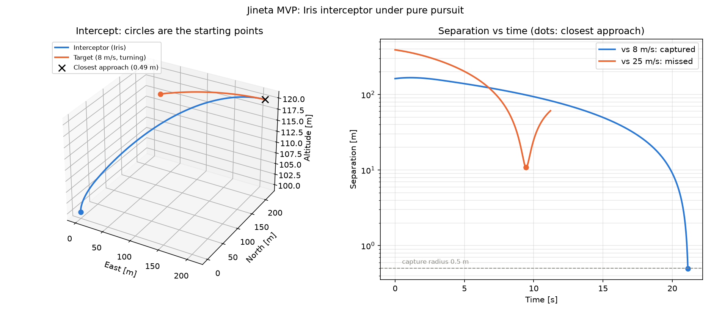

# Jineta

A multi-agent air-defence simulator: incoming aerial threats against a group of
interceptor drones that coordinate to neutralise them, with realistic 6-DOF rigid-body
physics. The goal is to **compare coordination strategies** — target assignment,
centralised versus distributed command, robustness to losing comms or an interceptor —
through Monte Carlo analysis.

The name comes from the *jineta*, the historical Spanish light cavalry: small, agile
units that coordinated hit-and-run attacks.

> **Status: phase 8 done.** The stage is built — 6-DOF interceptors and threats,
> several of them in one world, scenarios written as YAML files — and every
> engagement so far is the **baseline** the strategies will be compared against:
> perfect information, pure pursuit, each interceptor assigned its threat by hand in
> the scenario file, no coordination. See [Today and the goal](#today-and-the-goal)
> and [`DESIGN.md`](DESIGN.md) for the roadmap and the decision log.

## Today and the goal

The question Jineta is built to answer is **which way of coordinating a swarm of
interceptors works best, and in which scenarios**. Each row below is one part of
that question; today every row is in its simplest form, on purpose, so that each
later phase changes one thing and its effect can be measured against this baseline.

| | Today: the baseline (phases 1–8) | Coming |
|---|---|---|
| What an interceptor knows | The true position of its threat, perfectly | Sensors with noise and a Kalman filter that estimates position and velocity (phase 9) |
| How it flies at it | Pure pursuit: straight at where the threat is now | Guidance that predicts, such as proportional navigation: aim where it will be (phase 10) |
| Who chases whom | Fixed by hand in the scenario file, one interceptor per threat; it takes off when its own threat enters its pad's alert range | Assignment strategies, from the simplest (in order of detection) to the nearest free interceptor or a cost-based allocation, and re-assignment when a threat gets through or an interceptor is lost (phase 11) |
| Coordination | None: each interceptor flies alone | Centralised against distributed command, communications and their loss (phase 11) |
| The verdict | Captured or missed, pair by pair, one run | Statistics over many runs per strategy and scenario: Monte Carlo (phase 13) |

The scenario files are what makes the comparison possible: the same threats, pads
and interceptors can be flown with one strategy and then another.

## The MVP



A 3DR Iris quadrotor (the open PX4 SITL profile) flies under its own cascaded
autopilot — velocity → attitude → body rate → mixer → rotor speeds — against a
scripted threat, guided by **pure pursuit**: every control step it is told to fly
straight at where the target is right now.

Left: the intercept of a slow threat. Right: the separation over time for two
engagements. Both say something true about the vehicle:

- **Against a slow threat** (8 m/s, gently turning, interceptor commanded at 16 m/s)
  the separation grows for the first second — the quadrotor is accelerating from
  hover while the target flees — and then closes to the 0.5 m capture radius at
  t = 21.1 s. The closest approach is interpolated inside the step that contains it,
  not read off the nearest sample.
- **Against a fast threat** (25 m/s straight, interceptor commanded at 30 m/s) it
  nearly meets it head-on, misses by 10.8 m and is then left behind for good. The
  Iris never flew faster than 22.0 m/s: it was asked for 30. An interceptor-class
  airframe with a higher thrust-to-weight ratio is on the roadmap.

That second result is the kind of answer the simulator exists to give. An unwinnable
engagement is reported as unwinnable, not quietly rounded into a hit.

```powershell
python -m examples.iris_pursuit
```

## Interactive viewer

The same two engagements can be replayed in 3D in the browser:

```powershell
python -m examples.iris_pursuit_viewer   # writes docs\iris_pursuit_viewer.html and opens it
```

Drag to orbit, scroll to zoom, right-drag to pan, and scrub or play the timeline
(0.25–4×). It shows live telemetry (range, closure rate, speed against the ordered
speed, tilt), the line of sight the guidance steers along, velocity vectors, an
event log and the closest point of approach; cameras for overview, top view or
following the interceptor; and a cyan tactical or amber CRT palette (key **P**).

The viewer opens in its own window when `pywebview` is installed
(`pip install pywebview`), and in the browser otherwise. `python -m viz.app` opens
its start menu, where the scenario pages are listed by type of threat and start
(**Generic target · in the air**, **Generic target · scramble**, **Fixed wing ·
scramble**, **Two pads · several threats**); `python -m viz.app
docs\iris_scramble_viewer.html` reopens one page without simulating again, and
`--no-window` makes an example only write its files.

The viewer only replays data: the Python script runs the simulation and embeds the
results, in the simulator's own conventions, into one self-contained HTML file. It
needs an internet connection when opened (three.js loads from a CDN).

## Scramble: launch on alert

A more realistic start: the Iris waits on its pad at the origin, at rest with the
rotors stopped, and takes off when the threat comes within 400 m (straight-line
distance, as a radar would measure it). Then it climbs and flies pure pursuit.

- **A slow threat** (8 m/s, gentle turn, 110 m up) comes within range at T+13.1 s;
  the Iris climbs to it and catches it at T+36.9 s (0.48 m).
- **A fast threat** (25 m/s, straight, 120 m up) comes within range at T+12.9 s and
  is past before the Iris gets up to it: miss by 31.1 m at T+23.0 s. The Iris keeps
  chasing at its level top speed (20.7 m/s) and is 164 m behind when the threat
  leaves the dome at T+41.9 s, where the run ends.

```powershell
python -m examples.iris_scramble   # verdicts, range/altitude plot, then the viewer
```

The same viewer adds the alert dome around the pad, a standby phase before the
launch and the launch time on the timeline.

## Scramble against a fixed-wing drone

The same launch on alert, against a threat that is no longer a scripted point: a
generic small fixed-wing drone (Aerosonde-class open data from Beard & McLain's
*Small Unmanned Aircraft*), simulated in 6-DOF from its aerodynamic derivatives and
an electric motor + propeller model, and flown by its own autopilot (course,
altitude and airspeed hold by successive loop closure).

- **A loitering drone** flies in and circles 150 m around a point near the pad at
  18 m/s, 100 m up. It comes within range at T+20.7 s; the Iris, slightly faster,
  catches it at T+62.1 s (0.48 m).
- **A fast pass** at 30 m/s, straight, 120 m up, comes within range at T+10.7 s. The
  Iris misses it by 49.8 m at T+20.4 s and is left behind.

```powershell
python -m examples.fixed_wing_scramble   # verdicts, plot, then the viewer app
```

The viewer draws the drone as an aircraft with its real attitude (it banks 12.7° on
its orbit). Both aircraft fly in the same simulation loop and in the same ISA air,
each with its own autopilot.

Building the aircraft model also produced a few results that are tested against
flight-mechanics theory: the power-off glide angle (tan γ = −C_D/C_L), the trim for
level flight (12 to 32.5 m/s), and the five dynamic modes of the linearised model
against their classic approximations — Lanchester's phugoid is ~10 % fast, the
propeller (not the drag) is what damps it, and this airframe is spirally unstable,
which the autopilot cures.

## Scenario files and several entities

Every engagement above is a YAML file in `scenarios/`, not code. One folder is one
viewer page; one file is one case:

```yaml
name: "A · slow threat"
duration: 120                     # s
environment: {atmosphere: sea_level}
sites:
  - {id: pad, position: [0, 0], alert_range: 400}      # [north, east] in m
interceptors:
  - {id: iris, vehicle: iris, site: pad, target: threat, speed: 16}
threats:
  - {id: threat, kind: turning, position: [420, -250], altitude: 110,
     speed: 8, course_deg: 155, turn_rate_deg_s: -1.5}
```

A mistake in a file stops the run with a message that says where it is and what was
probably meant (`interceptors[0].vehicle: unknown vehicle 'irs'; did you mean
'iris'?`). Vehicles are named by their profile; the numbers stay in code next to
their sources.

All the entities of a scenario fly together in one world: their states are stacked
into one vector and integrated by the same RK4 loop, and every interceptor's
guidance reads the same snapshot of the world at the start of each step. A referee
judges each interceptor → target pair after every step: a capture destroys both, a
pass or a target that leaves the alert dome ends the pair, and a pair whose target
was destroyed by someone else loses it.

The new **two pads** page shows it: in case A, three threats against two pads, one
Iris assigned to each (two caught, one escapes); in case B, two Iris from different
pads chase the same loitering drone, one catches it and the other is left with no
target. The viewer draws every vehicle and shows every pair's range, status and
closest approach at once; clicking a pair (or key **N**) moves the camera and the
detailed telemetry to it. The start menu lists every case and pair with its result.

```powershell
python -m examples.run_scenarios          # every scenario folder, then the menu
python -m examples.run_scenarios scenarios\two-pads
```

## What works today

| Layer | Package | Contents |
|---|---|---|
| Physics engine | `jineta/core` | RK4 and Euler integrators, point mass with quadratic drag, quaternion algebra, Euler's equations, full 13-element 6-DOF rigid body, fixed-step simulation loop with pre/post-step hooks, closest-approach interpolation |
| Environment | `jineta/campo` | ISA atmosphere 0–20 km, wind models (constant, altitude profile, power-law boundary layer, 1-cosine gust, sums of models) |
| Vehicles | `jineta/jinete` | Airspeed in body axes, multirotor force model (thrust, reaction torques, rotor drag, body drag), rotor mixer built from the geometry, cascaded autopilot, vehicle profiles as data, pure pursuit guidance, scripted and recorded targets; fixed-wing air data (V, α, β), aerodynamics (stability derivatives, stall, drag polar), electric motor + propeller, trim, linearisation and dynamic modes, autopilot (course, altitude, airspeed) and orbit guidance for a generic small UAV |
| Arena | `jineta/arena` | The world loop (every entity of a scenario in one RK4 run, waiting and destroyed entities), engagements judged per pair (capture, pass, escape, loss), launch rules (on alert, at a time), scenario files in YAML (validated, clear errors) built into a world |
| Visualisation | `examples/`, `viz/` | matplotlib figures, a standalone three.js viewer that replays engagements with every interceptor and threat (`viz/viewer.py`, `viz/pages.py` export them) and a start menu built from the scenario files |
| Sensors, assignment, coordination | `jineta/atalaya`, `capitan`, `escuadron` | Empty: phases 9–11 |

Every physics module is tested against an analytic or otherwise known result — free
fall, terminal velocity, the standard ISA table, hydrostatic equilibrium, the
Dzhanibekov effect, the exact discrete response of a closed loop under a zero-order
hold — rather than against a previously recorded output.

**The simulator never draws.** It produces data (states and events over time);
plotting is a separate layer that reads it. Today that is matplotlib and the
three.js viewer; a CesiumJS export for multi-drone scenarios over real terrain comes
in phase 12.

## Running it

Windows PowerShell, from the repository root:

```powershell
python -m venv .venv
.\.venv\Scripts\Activate.ps1
pip install -r requirements.txt

pytest -n auto                 # the test suite, on every core (pytest -v: one by one)
ruff check . ; ruff format .   # style
python -m examples.run_scenarios   # fly every scenario file, write the pages
python -m examples.iris_pursuit    # the figure above
python -m examples.iris_scramble
python -m examples.fixed_wing_scramble
python -m viz.app              # the viewer app on its start menu
```

Other examples: `projectile_drag`, `density_comparison`, `density_comparison_2`,
`dzhanibekov`, `tumbling_projectile`, `wind_comparison`, `wind_gust`,
`iris_velocity_step` — all run the same way, `python -m examples.<name>`.

## Conventions

The ones that matter when reading any file (the rest are in `DESIGN.md`):

- **SI units everywhere** (m, s, kg, rad, N). Degrees only at the input and output edges.
- **NED frame**: x North, y East, z **Down**. Altitude is `-z` and gravity is positive
  along z.
- **Quaternions `[w, x, y, z]`**, scalar first, rotating body → NED. Euler angles are
  for display only.
- **Rigid-body state** (13 elements): `[x, y, z, vx, vy, vz, qw, qx, qy, qz, p, q, r]` —
  position and velocity in NED, attitude as a quaternion, angular rate in body axes.
- **Environment models are callables**: a density model is `altitude -> rho`, a wind
  model is `(t, position) -> wind velocity`, so any of them can be swapped or combined.
- **Vehicle parameters are data, not code**: one frozen dataclass per airframe in
  `jineta/jinete/profiles.py`, every number with a comment saying where it came from.
- **Scenarios are data too**: YAML files in `scenarios/`, positions as `[north,
  east]` plus an altitude, angles in degrees only there (the key says `_deg`).

Vehicle parameters come from open sources (published platforms, PX4 SITL models).
Threats are generic, representative classes with plausible public numbers — not
reproductions of specific real weapons. The value of the project is the engagement and
coordination analysis, not weapon data.

## Roadmap

Phases 1–8 are done: integrators, point mass, rotation, 6-DOF rigid body,
atmosphere and wind, the Iris quadrotor with its control cascade, this MVP, a
generic fixed-wing threat with its own autopilot, and YAML scenarios with several
entities in one world. Next: sensors and a Kalman filter, proportional navigation,
the coordination strategies, real terrain with Cesium, and a Monte Carlo study. The table in
[`DESIGN.md`](DESIGN.md#5-roadmap) tracks them.

## Licence

MIT — see [`LICENSE`](LICENSE).