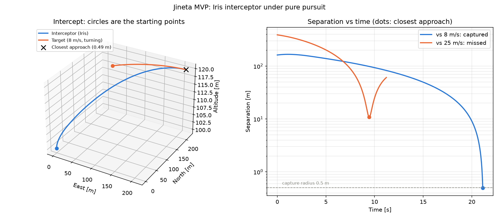

# Jineta

A multi-agent air-defence simulator: incoming aerial threats against a group of
interceptor drones that coordinate to neutralise them, with realistic 6-DOF rigid-body
physics. The goal is to **compare coordination strategies** — target assignment,
centralised versus distributed command, robustness to losing comms or an interceptor —
through Monte Carlo analysis.

The name comes from the *jineta*, the historical Spanish light cavalry: small, agile
units that coordinated hit-and-run attacks.

> **Status: end-to-end MVP (phase 7 of 13).** One interceptor, one scripted target,
> perfect information, the simplest guidance law that works. Sensors, several agents,
> real terrain and the coordination strategies — the actual point of the project — come
> later. See [`DESIGN.md`](DESIGN.md) for the full roadmap and decision log.

## The MVP



A 3DR Iris quadrotor (the open PX4 SITL profile) flies under its own cascaded
autopilot — velocity → attitude → body rate → mixer → rotor speeds — against a
scripted threat, guided by **pure pursuit**: every control step it is told to fly
straight at where the target is right now.

Left: the intercept of a slow threat. Right: the separation over time for two
engagements. Both say something true about the vehicle:

- **Against a slow threat** (8 m/s, gently turning, interceptor commanded at 16 m/s)
  the separation grows for the first second — the quadrotor is accelerating from
  hover while the target flees — and then closes to the 0.5 m capture radius at
  t = 21.1 s. The closest approach is interpolated inside the step that contains it,
  not read off the nearest sample.
- **Against a fast threat** (25 m/s straight, interceptor commanded at 30 m/s) it
  nearly meets it head-on, misses by 10.8 m and is then left behind for good. The
  Iris never flew faster than 22.0 m/s: it was asked for 30. An interceptor-class
  airframe with a higher thrust-to-weight ratio is on the roadmap.

That second result is the kind of answer the simulator exists to give. An unwinnable
engagement is reported as unwinnable, not quietly rounded into a hit.

```powershell
python -m examples.iris_pursuit
```

## Interactive viewer

The same two engagements can be replayed in 3D in the browser:

```powershell
python -m examples.iris_pursuit_viewer   # writes docs\iris_pursuit_viewer.html
start docs\iris_pursuit_viewer.html
```

Drag to orbit, scroll to zoom, right-drag to pan, and scrub or play the timeline
(0.25–4×). It shows live telemetry (range, closure rate, speed against the ordered
speed, tilt), the line of sight the guidance steers along, velocity vectors, an
event log and the closest point of approach; cameras for overview, top view or
following the interceptor; and a cyan tactical or amber CRT palette (key **P**).

The viewer only replays data: the Python script runs the simulation and embeds the
results, in the simulator's own conventions, into one self-contained HTML file. It
needs an internet connection when opened (three.js loads from a CDN).

## Scramble: launch on alert

A more realistic start: the Iris waits on its pad at the origin, at rest with the
rotors stopped, and takes off when the threat comes within 400 m (straight-line
distance, as a radar would measure it). Then it climbs and flies pure pursuit.

- **A slow threat** (8 m/s, gentle turn, 110 m up) comes within range at T+13.1 s;
  the Iris climbs to it and catches it at T+36.9 s (0.48 m).
- **A fast threat** (25 m/s, straight, 120 m up) comes within range at T+12.9 s and
  is past before the Iris gets up to it: miss by 31.1 m at T+23.0 s.

```powershell
python -m examples.iris_scramble   # verdicts, range/altitude plot, docs\iris_scramble_viewer.html
start docs\iris_scramble_viewer.html
```

The same viewer adds the alert dome around the pad, a standby phase before the
launch and the launch time on the timeline.

## What works today

| Layer | Package | Contents |
|---|---|---|
| Physics engine | `jineta/core` | RK4 and Euler integrators, point mass with quadratic drag, quaternion algebra, Euler's equations, full 13-element 6-DOF rigid body, fixed-step simulation loop with pre/post-step hooks, closest-approach interpolation |
| Environment | `jineta/campo` | ISA atmosphere 0–20 km, wind models (constant, altitude profile, power-law boundary layer, 1-cosine gust, sums of models) |
| Vehicles | `jineta/jinete` | Airspeed in body axes, multirotor force model (thrust, reaction torques, rotor drag, body drag), rotor mixer built from the geometry, cascaded autopilot, vehicle profiles as data, pure pursuit guidance, scripted targets |
| Engagement | `jineta/engagement.py` | One interceptor against one target: runs the loop, stops on capture or on a miss, reports the miss distance and time |
| Visualisation | `examples/`, `viz/` | matplotlib figures, and a standalone three.js viewer that replays engagements (`viz/viewer.py` exports them) |
| Sensors, assignment, coordination | `jineta/atalaya`, `capitan`, `escuadron` | Empty: phases 9–11 |

Every physics module is tested against an analytic or otherwise known result — free
fall, terminal velocity, the standard ISA table, hydrostatic equilibrium, the
Dzhanibekov effect, the exact discrete response of a closed loop under a zero-order
hold — rather than against a previously recorded output.

**The simulator never draws.** It produces data (states and events over time);
plotting is a separate layer that reads it. Today that is matplotlib and the
three.js viewer; a CesiumJS export for multi-drone scenarios over real terrain comes
in phase 12.

## Running it

Windows PowerShell, from the repository root:

```powershell
python -m venv .venv
.\.venv\Scripts\Activate.ps1
pip install -r requirements.txt

pytest -v                      # the test suite
ruff check . ; ruff format .   # style
python -m examples.iris_pursuit
python -m examples.iris_pursuit_viewer
python -m examples.iris_scramble
```

Other examples: `projectile_drag`, `density_comparison`, `density_comparison_2`,
`dzhanibekov`, `tumbling_projectile`, `wind_comparison`, `wind_gust`,
`iris_velocity_step` — all run the same way, `python -m examples.<name>`.

## Conventions

The ones that matter when reading any file (the rest are in `DESIGN.md`):

- **SI units everywhere** (m, s, kg, rad, N). Degrees only at the input and output edges.
- **NED frame**: x North, y East, z **Down**. Altitude is `-z` and gravity is positive
  along z.
- **Quaternions `[w, x, y, z]`**, scalar first, rotating body → NED. Euler angles are
  for display only.
- **Rigid-body state** (13 elements): `[x, y, z, vx, vy, vz, qw, qx, qy, qz, p, q, r]` —
  position and velocity in NED, attitude as a quaternion, angular rate in body axes.
- **Environment models are callables**: a density model is `altitude -> rho`, a wind
  model is `(t, position) -> wind velocity`, so any of them can be swapped or combined.
- **Vehicle parameters are data, not code**: one frozen dataclass per airframe in
  `jineta/jinete/profiles.py`, every number with a comment saying where it came from.

Vehicle parameters come from open sources (published platforms, PX4 SITL models).
Threats are generic, representative classes with plausible public numbers — not
reproductions of specific real weapons. The value of the project is the engagement and
coordination analysis, not weapon data.

## Roadmap

Phases 1–6a and 7 are done: integrators, point mass, rotation, 6-DOF rigid body,
atmosphere and wind, the Iris quadrotor with its control cascade, and this MVP. Next
come a generic fixed-wing threat model, YAML scenarios with several entities, sensors
and a Kalman filter, proportional navigation, the coordination strategies, real terrain
with Cesium, and a Monte Carlo study. The table in
[`DESIGN.md`](DESIGN.md#5-roadmap) tracks them.

## Licence

MIT — see [`LICENSE`](LICENSE).